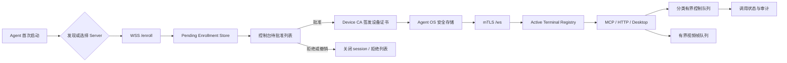

# AT-PC 全面优化落地计划

> **状态**：待实施
>
> **目标**：在不牺牲客户端首次启用便利性的前提下，完成设备准入、控制面可靠性、桌面流性能、规模化控制台、跨平台能力呈现和可观测性的系统性升级；所有工作必须以可自动验证、可实机复检、可回滚为完成标准。
>
> **本计划不是实现记录**：每一里程碑只有在“代码、自动测试、性能/安全门禁、真实环境复检、文档”均满足对应退出条件后，才可标记完成。

---

## 1. 范围、非目标与成功定义

### 1.1 范围

本计划覆盖以下已确认的优化点：

1. 客户端便捷注册与设备准入；
2. WebSocket 控制面背压、调用生命周期和断线可靠性；
3. 桌面流 CPU、带宽、远程桌面交互与帧传输效率；
4. 大规模终端注册表与控制台同步效率；
5. Agent 配置、网络身份、重连和本地 GUI 体验；
6. 终端能力发现、跨平台操作呈现和高风险操作保护；
7. 审计、指标、配额、路径安全和文档一致性；
8. 测试、性能门禁、真实环境复检、发布和回滚程序。

### 1.2 明确非目标

- **不要求管理员在 Agent 首次启用时复制、粘贴或保管 Device Token / API Key。**
- 本期不试图替换现有 MCP、RBAC、审计或桌面输入协议；只在兼容迁移窗口内扩展协议。
- 不把“测试命令退出码为 0”当作完成证据；必须验证行为、负向场景和可观测证据。
- 不因优化而默认扩大远程控制权限；未批准设备、低权限操作者和不支持的目标平台必须 fail closed。

### 1.3 量化成功标准

| 维度 | 最终标准 |
|---|---|
| 首次启用 | 用户仅需启动 Agent（可由局域网发现服务器或一次填写地址）；管理员在控制台一次点击批准后，无重启、无复制 Token 即上线。 |
| 未批准设备 | 可显示为“待批准”，但不能进入在线终端注册表、不能接收工具调用/桌面流/输入、不能访问控制面 API。 |
| 已批准设备 | 使用设备私钥对应的 mTLS 身份连接；证书续期对用户透明；吊销后下一次握手和当前会话均失效。 |
| 控制可靠性 | 控制消息有界、分类背压；任何被拒绝、取消、超时或断开的调用均能查询最终状态和原因。 |
| 大规模 | 在 5,000 活跃终端、5 秒心跳、控制台实时更新和并发 MCP 调用的混合负载下，有明确 p50/p95/p99 SLO。 |
| 可观测性 | 注册、批准、拒绝、队列饱和、调用状态转换、帧丢弃、重连原因、权限拒绝均可在指标和审计中追踪。 |
| 质量门禁 | Rust、前端、协议兼容、E2E、安全、负载、性能、真实环境复检均有可重复命令和留档产物。 |

---

## 2. 当前现状与问题基线

### 2.1 已有优势（应保留）

| 领域 | 当前实现 | 保留原则 |
|---|---|---|
| 桌面流 | `desktop-core` 已有 1280 默认输出上限、64-bit 分块 hash、静态帧跳过 JPEG、500 ms keepalive、交互期间更灵敏的脏帧判定。`stream.rs` 将截屏/编码放入 `spawn_blocking`，二进制帧队列容量为 2 并在满时丢旧帧。 | 保留“视频可丢旧帧、控制不可静默丢失”的分类理念。 |
| 控制调用 | `McpRouter` 已有 `call_id`、oneshot 等待、超时、最佳努力取消和终端断开时清理 pending calls。 | 将其扩展为完整状态机，而不是推倒重写。 |
| 审计 | 服务端审计采用有界队列、单后台写者、重试、轮转和 Unix 0600 权限。 | 将新注册/批准/撤销事件纳入同一审计链。 |
| 用户交互 | Agent 有 tray、紧急断开、重连、终端 ID 复制和本地审计；控制台有多屏、输入释放、任务取消、密钥管理、终端标签与筛选。 | 保留现有高频操作路径，增加状态可解释性。 |
| 工程门禁 | CI 已覆盖 fmt、Clippy、workspace tests、前端 lint/typecheck/test/build、跨平台 check、cargo-deny/audit 与性能探针。 | 在现有 CI 上叠加行为和负载门禁，避免另起不可维护的验证体系。 |

### 2.2 必须解决的基线缺口

| ID | 现状证据 | 风险/影响 | 优化方向 |
|---|---|---|---|
| B-01 | `crates/server/src/ws/handler.rs` 的 `Register { info, auth_token: _ }` 丢弃注册凭据；`p2_device_token_test.rs` 还将“无凭据、任意凭据、绑定 ID 不一致均成功”作为旧契约。 | 任意可连 9801 的进程可冒充/覆盖终端 ID；README 的设备绑定描述与实际不符。 | 改为“待批准设备 + mTLS 设备身份”；移除用户预置 Token 依赖。 |
| B-02 | Agent 与 Server 控制通道使用 `mpsc::unbounded_channel`，视频帧却已采用容量为 2 的有界队列。 | 慢网、卡死 Agent 或突发工具调用可导致控制面无界内存增长。 | 有界分类队列、明确拒绝/合并/保留语义及指标。 |
| B-03 | 非 Windows 流路径先对原始 RGBA 全尺寸画面 hash，再进行缩放与 JPEG。 | 4K/超宽屏在默认 1280 输出时仍支付原始分辨率 hash 成本。 | 对缩放后画面 hash，或引入低成本源预判；以视觉回归验证。 |
| B-04 | 现有 registry 基准和测试覆盖 1k/5k 的局部操作；`p2_perf_deep.rs` 明确提示元数据写路径可能随记录规模增长。 | 单机平均耗时不能代表持续心跳、列表刷新、重连和 MCP 调用并发的真实集群。 | 增加混合负载压测与 p95/p99 SLO。 |
| B-05 | Server 和 Agent 默认工具超时均约 35 秒；超时后结果可能成为 unknown/expired。 | 控制台和 MCP 无法清晰区分成功、取消、超时、断线和延迟回包。 | 定义调用状态机、原因码、历史查询和幂等策略。 |
| B-06 | 配置文件不存在、读取失败或 TOML 解析失败时，Agent 会继续尝试并可能静默退回默认地址。 | 用户很难定位“配置无效却连接了默认服务器”的问题。 | 配置来源、严格校验、`--check-config`、有效配置预览和 GUI 诊断。 |
| B-07 | Web 控制台每 2 秒轮询全部终端并再查询运行中任务；Agent GUI 250 ms 固定重绘。 | 终端数上升后造成不必要的网络、DOM、锁竞争和待机功耗。 | 事件增量同步、页面可见性降频、增量渲染、GUI 事件驱动刷新。 |
| B-08 | Agent 使用固定间隔重连，桌面通道固定 1.5 秒重连，GUI 文案却称“指数退避”。 | 网络故障时无抖动重试可能形成尖峰，且用户对状态预期错误。 | 实现带 jitter 的指数退避并显示下一次重试和失败原因。 |
| B-09 | 控制台对任意终端提供 PowerShell/Windows 服务等入口；README 已标明部分功能为 Windows 专属。 | 用户会在不支持的平台上执行失败操作，增加误操作和排障成本。 | Agent 上报 capability；前端、MCP 和权限统一按能力裁剪。 |
| B-10 | 截图协议为兼容性暴露多个 Base64 字段；内部共享字符串并不等于 JSON 网络载荷不重复。 | 非桌面 WebSocket 路径可能重复编码/传输大图。 | 单一规范字段、按需图像、二进制/短期下载路径。 |
| B-11 | 既有实机复验记录到桌面路径免配额和归一化路径绕过风险；前端还混合 `innerHTML` 与 inline handler。 | 桌面端点可被放大请求；攻击者可利用终端元数据扩大前端注入面。 | 端点级配额策略与路由归一化测试；集中 DOM 转义/事件绑定。 |
| B-12 | 终端自动 LAN IP 选择可能取到非业务网卡/APIPA 地址。 | 控制台展示和网络诊断误导用户。 | 根据到 Server 路由选择接口，并上报候选地址及选择理由。 |

---

## 3. 核心设计：免预置 Token 的“待批准设备注册 + mTLS 身份”

### 3.1 设计决策

本项目不再将 `device_token`、共享 `auth_token` 或管理员复制的注册码作为 Agent 首次接入前提。取而代之的是：

> **Agent 自生成设备密钥对 → 仅申请注册、默认待批准 → 管理员在控制台查看并点击批准 → Server 绑定公钥并签发 mTLS 设备证书 → Agent 自动以设备证书重连并上线。**

这里的设备私钥是操作系统托管的密码学材料，不是用户要复制、粘贴、传递或长期保管的 Token/Key。私钥永不离开本机；Server 只保存公钥指纹、证书序列号和设备审批状态。

设计参考了 Tailscale 的设备审批模式：新设备显示为待审批，批准前不能访问受保护网络资源，管理员在控制台审核详情后批准，批准立即生效且不要求设备重启。[Tailscale Device approval](https://tailscale.com/docs/features/access-control/device-management/device-approval)

*该参考内容已为遵守许可限制而转述。*

### 3.2 用户路径（默认，优先便利）

1. 用户安装并启动 Agent；无需输入或粘贴 Token。
2. Agent 按优先级寻找 Server：已保存地址 → 局域网 mDNS `_at-pc._tcp` 发现 → GUI 一次性填写 URL/扫码打开本地配置页。
3. Agent 建立 TLS 连接，生成或读取本机持久化 Ed25519/P-256 设备密钥对，并发送签名的 `EnrollmentRequest`。
4. Server 创建/刷新一条 **待批准**请求。Agent GUI/tray 显示“正在等待管理员批准”，显示设备名、Server 名称和六词核验短语；用户不需要输入该短语。
5. 管理员在 Web 控制台“待批准设备”列表查看主机名、OS、版本、局域网地址、首次/最近请求时间、公钥指纹、请求源 IP、核验短语和能力概要，点击“批准”。
6. Agent 仍在同一条已加密的 enrollment 会话中收到批准消息，自动完成 CSR/证书安装并 mTLS 重连。控制台立即显示 Online，无需重启或二次操作。
7. 管理员可禁用、撤销、删除、重新批准设备。撤销立即终止其活跃 session，并将证书序列号加入拒绝列表。

### 3.3 安全边界与便利性平衡

| 状态 | 可执行动作 | 明确禁止动作 |
|---|---|---|
| `Pending` | 保持 enrollment 长连接、刷新申请、显示本地状态、提交有限诊断元数据。 | 进入活跃 Registry、接收 InvokeTool、接收/发送桌面帧、处理输入、访问 MCP/控制台 API。 |
| `Approved` | 获得 mTLS 设备身份，正常注册、心跳、工具调用与桌面流。 | 使用操作端 API Key 身份、替换为其他终端 ID、在证书过期/撤销后继续操作。 |
| `Rejected` | 显示拒绝原因和可重试时间。 | 高频重试、保留控制会话。 |
| `Revoked` | 显示本地“已撤销，需要管理员重新批准”。 | 用旧证书或旧 session 重连。 |

这是对用户假设“无关电脑一般不会主动注册”的分层处理：无关电脑即便发起请求，也只会产生受限且可清理的 `Pending` 记录，不会把控制权交给 Server；真实用户仍只需启动 Agent 和等待一次管理员审批。

### 3.4 协议与存储模型

#### 3.4.1 新增数据模型

在 `crates/protocol` 中新增、版本化以下概念：

```text
EnrollmentRequest {
  protocol_version,
  enrollment_id,                // Server 分配的不可预测 ID，不是用户输入 Token
  stable_device_id,             // Agent 首次安装生成 UUID，不使用 hostname/MAC 作为主身份
  public_key_spki,
  proof_signature,              // 对服务端 nonce + 请求摘要签名，证明持有私钥
  device_facts { hostname, os, agent_version, local_addresses, install_id },
  capabilities,
  client_nonce
}

EnrollmentStatus { Pending | Approved | Rejected | Revoked }
EnrollmentResponse { status, server_nonce, approval_phrase?, retry_after_secs?, reason_code? }
DeviceCertificateBundle { certificate_chain_pem, expires_at, serial, renewal_after }
```

关键约束：

- `stable_device_id` 仅是设备记录定位符，**授权绑定以公钥指纹和证书 Subject/SAN 为准**；hostname、MAC、IP 均只作为可变展示信息。
- Server nonce 必须单次使用且有短 TTL；签名覆盖所有安全相关字段，防重放、换 ID、替换公钥或降级协议。
- `approval_phrase` 是“控制台与本机屏幕可比对的视觉确认信息”，不是网络凭据、不是 API Token、无需用户提交；审批不依赖它也能完成。
- `EnrollmentRequest` 与控制 WebSocket 分离，建议端点为 `/enroll`。现有 `/ws` 仅接受有效 mTLS Agent session，避免把待审批状态混进活跃 Registry。

#### 3.4.2 Server 数据表/持久化

新增 `DeviceEnrollmentStore`，独立于 `TerminalMetaStore` 与旧 `KeyStore`：

| 字段 | 说明 |
|---|---|
| `device_id`、`public_key_fingerprint` | 唯一约束；公钥改变视为新设备或显式密钥恢复。 |
| `status`、`approved_by`、`approved_at`、`rejected_reason`、`revoked_at` | 状态机与审计来源。 |
| `certificate_serial`、`cert_not_after`、`last_renewed_at` | 证书生命周期。 |
| `facts_snapshot`、`capabilities` | 审批时展示的最小设备信息；变更保留历史摘要。 |
| `first_seen`、`last_seen`、`source_ip`、`request_count` | 反滥用与运维诊断。 |

状态转换必须是事务性 compare-and-swap：

```text
Pending -> Approved -> Revoked
Pending -> Rejected
Rejected -> Pending              (经退避后重新申请)
Revoked -> Pending               (重新安装/重新批准)
Approved -> Pending              (管理员显式要求重新审批)
```

任何非法转换直接拒绝并写审计。只允许 Admin 批准/撤销/删除；Operator 可查看且可添加备注，但不能改变准入状态。

#### 3.4.3 证书与密钥管理

- Server 生成或加载独立的 Device CA；其私钥仅存于 Server 数据目录，并按现有敏感文件权限策略保护。
- Agent 私钥优先存 OS 安全存储：macOS Keychain、Windows DPAPI/Credential Manager、Linux Secret Service；不可用时使用受限文件并记录降级告警。
- Agent 在本机生成私钥和 CSR，Server **绝不**向 Agent 下发私钥。
- 设备证书 SAN 同时包含 `device_id` 和公钥指纹，期限建议 30 天，`renewal_after` 建议 20 天；续期走现有 mTLS 通道，用户无感。
- Server 每次 mTLS 握手校验证书链、有效期、序列号撤销状态、SAN 的 `device_id`/指纹绑定及协议版本。
- 被撤销设备的现有 WS session 立即关闭，pending call 以 `device_revoked` 失败；重新上线只能重走待批准流程。
- 非回环 enrollment 强制 TLS；开发模式的明文 enrollment 必须显式 `--allow-insecure-enrollment`，启动时显示高风险警告并写入审计，不能由默认配置开启。

### 3.5 防滥用措施（不降低首启便利性）

1. **Pending 不授予控制权**：这是首要安全边界。
2. 按源 IP、设备指纹、Server 全局设置并发申请上限；同指纹仅刷新同一 Pending 请求，不重复制造记录。
3. Pending 记录默认 24 小时过期，控制台可一键清理；超限时采用退避响应，不无限保持连接。
4. 仅保留审批所需最小信息；完整审计中对 IP、证书指纹和本地地址做最小化/脱敏展示。
5. Server 支持可选网络策略：仅局域网 CIDR、显式 allowlist、只允许 mDNS 发现来源。默认策略仍为“任何网络可申请、管理员批准后才可控制”，保证快速启用。
6. 设备 ID 冲突、公钥与已批准设备不匹配、证书用于不同 device ID、过期/撤销证书均 fail closed。

### 3.6 旧 Token 的兼容和退出

- **新安装默认**：不读取、不展示、不需要 `device_token` 或 `auth_token`。
- **旧 Agent 兼容窗口**：由 Server 配置 `legacy_device_token_mode = disabled | observe | allow_until` 控制；默认新部署为 `disabled`。
- `observe` 只记录旧 Token 尝试和引导语，不赋予上线权限；`allow_until` 必须有明确到期时间、启动警告和审计。
- 旧 device token 迁移方式：旧 Agent 首次用旧模式连接时只创建 Pending 记录；管理员批准后换取设备证书。迁移完成即不再使用旧 Token。
- 在两个稳定发布周期且迁移指标达到 95% 后，删除 Agent CLI/env/config 中的 `--device-token`、`--auth-token` 设备注册路径，并删除“无 Token/任意 Token 成功”的测试契约。

---

## 4. 目标架构与工作流分层



### 4.1 控制面队列策略

| 消息类型 | 队列 | 饱和行为 | 监控指标 |
|---|---|---|---|
| `InvokeTool` | 有界可靠队列 | 返回 `control_queue_full`；不丢弃、不隐式重试。 | depth、rejected、wait_ms |
| `ToolResult` / `CancelTool` | 有界可靠高优队列 | 保留更高优先级；饱和触发 session unhealthy 并断开重连。 | delivery_latency、forced_disconnect |
| 心跳 | 容量 1 的 latest-value 槽 | 覆盖旧心跳。 | coalesced_heartbeats |
| 鼠标移动 | 容量 1 的 latest-value 槽 | 合并为最新坐标。 | coalesced_mouse_moves |
| 键盘/鼠标按下抬起 | 有界可靠队列 | 满时拒绝并向用户显示“输入通道拥塞”，绝不能悄悄丢按键。 | rejected_input_events |
| 二进制视频帧 | 保持容量 2 | 丢弃陈旧帧，保留最近帧。 | dropped_frames、queue_depth |

### 4.2 工具调用状态机

```text
Created -> Queued -> Dispatched -> Running
Running -> Succeeded | Failed | Cancelling | TimedOut | DeviceDisconnected | DeviceRevoked
Cancelling -> Cancelled | Failed | TimedOut | DeviceDisconnected | DeviceRevoked
```

每个终态都要包含 `reason_code`、`server_observed_at`、`agent_observed_at?`、`duration_ms`、`attempt` 与 `correlation_id`。MCP、REST、前端运行任务窗口和审计必须读取同一状态源。

---

## 5. 分里程碑实施计划

### M0：基线冻结、风险隔离与可观测准备

**目的**：使后续改动可对照、可回归、可定位。

| 工作项 | 具体交付物 |
|---|---|
| 建立行为基线 | 将当前“无凭据/任意凭据/错绑定仍注册”的测试明确标记为 **legacy regression**，不得继续作为期望行为；保留失败复现样本。 |
| 建立指标接口 | 定义 Prometheus/JSON 指标命名：enrollment、queues、tool lifecycle、stream、registry、frontend sync、reconnect。 |
| 建立审计事件 | `enrollment_requested/approved/rejected/revoked`、`certificate_issued/renewed/rejected`、`queue_saturated`、`tool_state_changed`。 |
| 文档纠偏 | README 和配置示例先移除“当前已严格绑定 Device Token”“指数退避已实现”等不实承诺，改为版本化能力说明。 |
| 路由安全清点 | 为所有 `/desktop/`、MCP、WS、静态资源路径建立归一化后权限/配额矩阵。 |

**退出条件**：基线测试和风险清单已提交；每项指标有 owner、单位、标签控制策略和 dashboard 草图。

### M1：Pending Enrollment 数据模型与只读协议

**目的**：先实现“可申请但无控制权”，不立即改动活跃控制 WS。

| 工作项 | 具体改动方向 |
|---|---|
| 协议 | 在 `protocol` 增加 enrollment 消息、状态、错误码和 capability schema；新增版本协商。 |
| Server | 新建 enrollment handler/store；`Pending` 不调用 `TerminalRegistry::register`。 |
| Agent | 生成稳定 UUID 与设备密钥对；优先 OS 安全存储；新增 enrollment 状态页和 CLI 状态输出。 |
| 控制台 | 新增“待批准设备”列表，只读显示和审计入口，尚不提供批准按钮。 |
| 发现 | 实现 mDNS 广播/发现和手动 URL 回退；所有发现结果必须经 TLS 名称/证书校验。 |

**验收**：新 Agent 无 Token 启动后在控制台显示 Pending；`list_terminals`、MCP、desktop、输入均看不到/访问不到该设备。

### M2：管理员批准、mTLS 上线与撤销

**目的**：完成默认生产注册路径，既方便又不授权未批准设备。

| 工作项 | 具体改动方向 |
|---|---|
| PKI | 实现 Device CA、CSR、设备证书、30 天轮换、证书拒绝列表和 Server TLS/mTLS 验证。 |
| 审批 | 控制台实现详情、批准、拒绝、撤销、重新审批、设备备注和六词核验短语。 |
| WS | `/ws` 只接受 Approved 设备 mTLS 身份；从证书绑定设备 ID，忽略客户端声明的可变 `terminal_id` 作为授权来源。 |
| 会话 | 撤销时关闭活跃 session，终止 pending call，清除桌面流。 |
| 文档 | 新增“3 分钟首次接入”“批准前后状态”和“丢失设备恢复”指南。 |

**验收**：批准后无需重启 Agent 即上线；伪造、过期、撤销、错绑、SK/旧 Token、无证书均无法进入活跃 Registry。

### M3：旧 Device Token 迁移与删除

**目的**：消除双路径安全歧义。

| 工作项 | 具体改动方向 |
|---|---|
| 迁移模式 | 实现 `disabled/observe/allow_until`，默认 disabled；观察模式只建 Pending。 |
| 配置 | Agent 显示旧配置发现警告和一键迁移说明；Server 显示剩余旧客户端数。 |
| 淘汰 | 到期后删除旧注册逻辑、CLI 参数、环境变量、README 配置示例和旧正向测试。 |
| 兼容 | 对低版本 Agent 返回可行动的 `upgrade_required`/`enrollment_required`，不返回模糊连接失败。 |

**验收**：全新安装无 Token 上线；旧 Agent 可迁移；关闭迁移模式时任何 Token 都不能绕过 Pending/mTLS。

### M4：控制面背压、调用状态机和审计闭环

**目的**：消除无界队列和“未知结果”。

| 工作项 | 具体改动方向 |
|---|---|
| 队列 | 按 §4.1 替换所有控制类 `unbounded_channel`；视频队列保持当前丢帧策略。 |
| 状态 | 建立持久/短期调用历史，更新 Router、WS handler、Agent executor、HTTP/MCP 返回体和前端任务面板。 |
| 超时 | 按工具类别设置默认超时并允许上限受控覆盖；明确定义 Server/Agent 两端谁是权威超时源。 |
| 幂等 | 给只读工具提供安全 retry policy；副作用工具要求 idempotency key 或禁止自动重试。 |
| 压力保护 | 队列饱和、连续发送失败或结果无法投递时触发 session unhealthy、审计、指标和可见错误。 |

**验收**：慢消费者/断网/取消竞争/设备撤销下，无内存无界增长，无静默命令丢失，所有调用均有唯一终态。

### M5：桌面流、图像载荷和 Registry 规模化

**目的**：提升高分辨率与大规模场景的真实吞吐。

| 工作项 | 具体改动方向 |
|---|---|
| 桌面 hash | 实验性实现“缩放后 hash”及可选快速源预判；通过 feature flag 灰度，不直接替换。 |
| 自适应流 | 根据 RTT、帧积压、CPU、观看者可见性调节 FPS/quality/scale；维持输入后 600 ms 的交互优先。 |
| 图像 API | 把多 Base64 字段收敛为规范字段；仅在显式 `include_image=true` 返回图片；优先二进制和单次下载。 |
| Registry | 增加混合负载压测；若 SLO 不达标，再实施分片/读快照方案并做写放大对比。 |
| 控制台数据 | 终端列表改为事件增量，不再每 2 秒全量拉取；保留带退避的 fallback polling。 |

**验收**：视觉回归合格后，4K 静态流 CPU 降低；5k 混合负载达到批准的 p95/p99；控制台数据量随变更数而非终端总数增长。

### M6：配置、能力模型和跨平台 UX

**目的**：让用户看得到真实状态，只看得到可执行操作。

| 工作项 | 具体改动方向 |
|---|---|
| 配置诊断 | `--check-config`、`--print-effective-config`、解析错误 fail fast、配置来源展示、密钥/证书路径脱敏。 |
| 网络身份 | 按到 Server 的路由选取 LAN IP；上报候选地址、接口名、选择理由，避免 APIPA/虚拟网卡误导。 |
| Capability | Agent 注册能力：OS、shell、service control、UIA、Cocoa、display、desktop input、stream codec 等。 |
| 前端呈现 | 按 capability/role 状态隐藏或禁用操作并解释原因；不在 macOS/Linux 显示不可用的 PowerShell/Windows 服务工作流。 |
| 高风险确认 | 删除离线终端、杀进程、停服务、命令执行、密钥撤销、桌面输入采用权限、二次确认和可选理由。 |
| 前端安全 | 移除 inline `onclick`，集中事件委托；所有外部/终端字段统一使用安全 DOM API 或严格编码。 |

**验收**：无效配置有精确错误；多平台控制台无“点了才失败”；恶意 hostname/terminal metadata 无法注入 HTML/JS。

### M7：重连、待机功耗、远程桌面体验和运维指标

**目的**：降低故障噪声，提升用户对状态和降级的理解。

| 工作项 | 具体改动方向 |
|---|---|
| 退避 | Agent 和桌面 WS 使用指数退避 + full jitter，例如 1s/2s/4s…最高 30s，成功后重置；配置修改和用户“立即重连”可中断等待。 |
| 状态 | 显示失败分类、最近错误、重试次数、下次重试倒计时、TLS/证书有效期、Pending/Approved/Revoked 状态。 |
| GUI 待机 | 仅在窗口可见、状态变化、审计新增或 tray 事件时刷新；日志采用虚拟列表/增量读取。 |
| 桌面诊断 | 展示 RTT、接收 FPS、解码耗时、丢帧、输入通道、只读/控制状态；REST 降级时明确提示鼠标跟随暂停。 |
| 可访问性 | 键盘焦点、ARIA 标签、颜色之外的状态标识、中文/英文一致的错误文本。 |

**验收**：断网恢复不会形成固定周期重连尖峰；隐藏 Agent 窗口待机 CPU/唤醒下降；用户能区分“服务器不可达、证书错误、待批准、已撤销、桌面降级”。

### M8：文档、发布、容量复检与正式收口

**目的**：杜绝“功能代码存在但需求未落地”。

| 工作项 | 具体改动方向 |
|---|---|
| 文档 | README、配置模板、架构图、MCP 工具矩阵、权限矩阵、迁移手册和故障排查全面同步。 |
| Dashboard | 设备准入、队列、调用、桌面流、Registry、配额、证书到期和审计失败仪表盘。 |
| 发布 | Canary 环境、升级说明、数据库迁移、证书备份恢复、legacy 到期提醒、回滚包。 |
| 复检 | 执行 §6 全部自动/实机清单；由非实现人复测 P0 场景并签字。 |

**验收**：所有计划项均有需求 ID、PR、自动测试、实机证据、指标截图/导出、文档链接和回滚说明。

---

## 6. 测试、验收与复检程序

### 6.1 完成定义（DoD）

每个 PR 必须同时满足：

1. 明确关联本计划的 Milestone/Requirement ID；
2. 至少一项正向、一项负向、一项回归测试；
3. 新错误码、状态、指标和审计事件有契约测试；
4. 不修改测试来掩盖失败；若旧测试代表被废弃行为，必须在 PR 中说明、替换为反向断言并更新迁移说明；
5. 本地/CI 输出可复现，失败日志和基准原始数据保留为构建产物；
6. 对协议、认证、权限、桌面输入、删除/终止类变更，必须由第二位 reviewer 完成威胁建模检查。

### 6.2 分层测试矩阵

| 层级 | 必测内容 | 主要位置/命令 |
|---|---|---|
| Unit | enrollment 状态机、nonce 单次使用、签名验证、CSR/SAN 绑定、续期/撤销、密钥存储降级、backoff、队列分类、调用状态转换、路由归一化。 | `protocol`、`server`、`agent` 单元测试。 |
| Contract | WebSocket/Enrollment JSON 编解码、错误码稳定性、mTLS 拒绝语义、MCP/REST 调用状态字段、capability schema。 | protocol tests + golden fixtures。 |
| Integration | Pending 不能注册/调用；批准后 mTLS 重连；错公钥/错 ID/重放/过期/撤销失败；队列满；断线/取消竞争。 | `crates/server/tests`、`crates/agent/tests`。 |
| E2E | 真实 Server + Agent：首启、发现、批准、无需重启上线、撤销断连、恢复重新审批、多屏和输入。 | `crates/e2e-tests`，容器/VM fixture。 |
| Frontend | 待批准列表、审批/撤销、权限隐藏、增量更新、错误呈现、XSS、键盘可用性和路由状态。 | Node tests；引入浏览器 E2E 后使用 Playwright。 |
| 安全 | TLS downgrade、mTLS 错证书、重放、证书盗用模拟、请求洪泛、路径绕过、权限矩阵、输入越权。 | 独立 security test job。 |
| 性能 | 4K/5K 流、图像载荷、5k 混合 Agent、队列慢消费者、前端事件风暴、待机功耗。 | Criterion + load generator + perf thresholds。 |
| 实机复检 | macOS、Windows、Linux 各至少一台；真实 GUI、托盘、系统安全存储、显示器/DPI、TLS、弱网。 | 版本化验收记录。 |

### 6.3 设备准入必测案例

| 编号 | 场景 | 预期 |
|---|---|---|
| ENR-01 | 新 Agent 无 Token 首启 | Pending；控制台可见；Agent 显示等待批准。 |
| ENR-02 | Pending 设备调用 MCP/工具/桌面/输入 | 全部拒绝；不进入 `list_terminals`。 |
| ENR-03 | Admin 批准 Pending | Agent 无重启转为 mTLS Online；审计有完整批准链。 |
| ENR-04 | Viewer/Operator 尝试批准、撤销 | 403，且写 denied audit。 |
| ENR-05 | 重放旧 enrollment nonce/signature | 拒绝 `nonce_replayed`。 |
| ENR-06 | 同 device_id 不同公钥 | 创建新 Pending 或按策略拒绝；绝不覆盖已批准身份。 |
| ENR-07 | 同公钥伪造不同 device_id | 拒绝绑定冲突。 |
| ENR-08 | 使用操作端 `sk`、旧 `dv`、空字段、任意字符串连接 `/ws` | 不能进入活跃 Registry。 |
| ENR-09 | mTLS 证书过期/撤销/错误 CA/错 SAN | 握手拒绝；现有 session 被切断；pending call 终态为 `device_revoked` 或 `device_disconnected`。 |
| ENR-10 | 证书自动续期 | 到期前无用户操作完成轮换；旧证书/旧序列号失效策略符合配置。 |
| ENR-11 | 申请洪泛、同指纹重复、Pending 超时 | 受限、合并、自动清理；不影响 Approved 设备。 |
| ENR-12 | TLS 缺失的非回环 enrollment | Server 拒绝启动或拒绝连接，除非显式不安全开发开关。 |

### 6.4 控制与性能必测案例

| 编号 | 场景 | 预期 |
|---|---|---|
| CTRL-01 | Server/Agent 控制队列持续慢消费 | 内存有上界；可靠消息明确拒绝或触发 unhealthy；视频仍可丢旧帧。 |
| CTRL-02 | InvokeTool 与 CancelTool 并发竞争 | 一个且只有一个终态；调用历史和审计一致。 |
| CTRL-03 | Server 超时、Agent 超时、断线、撤销 | 不产生悬挂 pending；客户端能读到明确 reason code。 |
| STR-01 | 4K 静态桌面、默认 1280 输出 | 比较优化前后 CPU、hash 耗时、首帧时延；视觉 diff 无回归。 |
| STR-02 | 小文本变化、鼠标移动、输入 600 ms 内 | 交互反馈不遗漏，延迟满足产品阈值。 |
| REG-01 | 5k Agent×5 秒心跳 + 100 控制台订阅 + 并发 MCP | 采集 p50/p95/p99、CPU、RSS、锁等待；达不到 SLO 不可宣称支持 5k。 |
| WEB-01 | 5k 终端状态变更 1% | 只推送变更；前端不全量 `innerHTML` 重建。 |
| SEC-01 | `/desktop/../`、百分号编码、查询参数伪装、双斜杠 | 权限与配额仅基于规范化路由，所有绕过被拒绝或等价处理。 |

### 6.5 CI 门禁与发布前命令

在现有 CI 基础上，最终必须具备以下 job；耗时较长者可 nightly，但每个 release candidate 必跑：

```bash
# 静态和单元/集成基线
cargo fmt --all -- --check
cargo clippy --workspace --all-targets --all-features --locked -- -D warnings
cargo test --workspace --all-features --locked

# 前端基线
npm --prefix crates/server/frontend ci
npm --prefix crates/server/frontend run lint
npm --prefix crates/server/frontend run typecheck
npm --prefix crates/server/frontend test
npm --prefix crates/server/frontend run build

# 性能基线（release）
./scripts/check_perf_thresholds.sh

# 新增的发布门禁（实施后提供脚本）
./scripts/test_enrollment_contracts.sh
./scripts/test_enrollment_e2e.sh --matrix macos,windows,linux
./scripts/test_control_backpressure.sh
./scripts/load_registry_mix.sh --agents 5000 --duration 30m --assert-slo
./scripts/security_route_matrix.sh
./scripts/verify_docs_claims.sh
```

**禁止通过方式**：跳过失败测试、在 CI 中使用 `|| true`、只断言 HTTP 200/连接建立、只检查日志文本、或仅修改阈值而不附原始性能数据和批准记录。

### 6.6 真实环境复检模板

每次 release candidate 由非实现人执行并提交 `docs/releases/<version>-acceptance.md`，至少包含：

1. 构建 commit、二进制 SHA256、测试系统版本、Agent/Server 配置来源；
2. macOS、Windows、Linux 各一次无 Token 首启 → Pending → Admin 批准 → 无重启上线；
3. 撤销后立即断开、重新启动仍无法上线、重新批准后恢复；
4. 弱网/Server 重启下的 jitter backoff、恢复时间和重复请求数；
5. 多屏桌面、DPI、输入粘连释放、只读/控制状态、能力隐藏；
6. 5k 负载或等效可复现环境的原始报告；
7. 文档逐条对照：不宣称未验证的吞吐、安全或平台能力；
8. 所有失败项必须写“现象、日志、影响、修复 PR、复测结果”，不得用“已知问题”直接放行 P0/P1。

---

## 7. SLO、指标和告警

### 7.1 初始 SLO（M0 先采集基线，M5/M7 由数据确认最终值）

| 指标 | 初始目标 |
|---|---|
| Pending 创建到控制台可见 | p95 < 2 s |
| 管理员批准到 Agent Online | p95 < 5 s（同网络、正常 TLS） |
| 撤销到活跃控制 session 关闭 | p95 < 3 s |
| 控制队列饱和 | 0（正常容量测试）；发生时必须可诊断、内存不线性增长。 |
| 1080p/2560 hash | 保持现有 `thresholds.toml` 门禁或更严格。 |
| 5k 终端列表与更新 | 以混合负载下 p95/p99 取代单纯平均耗时声明。 |
| 前端状态同步 | 普通变更 p95 < 2 s；隐藏页面不进行高频全量同步。 |
| Agent 待机 | 隐藏窗口状态下 CPU/唤醒相较当前基线明显下降；目标值由 M7 实测确定。 |

### 7.2 必备指标

```text
enrollment_requests_total{result,source_class}
enrollment_pending_gauge
enrollment_approval_latency_seconds
device_certificate_events_total{action,result}
active_device_sessions_gauge
control_queue_depth{direction,class}
control_queue_rejected_total{direction,class}
tool_calls_total{state,tool_name}
tool_call_duration_seconds{tool_name,terminal_class}
stream_frames_total{result}
stream_frame_bytes_total
stream_dropped_frames_total
registry_operation_duration_seconds{operation}
frontend_sync_events_total{mode}
reconnect_attempts_total{reason}
```

标签不得直接包含 terminal ID、完整 IP、call ID 或高基数字段；详细排障使用审计 correlation ID。

---

## 8. 数据迁移、发布、回滚与事故处置

### 8.1 迁移原则

1. 数据库/JSON store 使用显式 `schema_version` 和可逆迁移；迁移前自动备份。
2. 先上线 Server 的“能识别 Pending 和 mTLS”的版本，再灰度 Agent；不可要求所有 Agent 同时升级。
3. 只允许从 legacy 到 Pending/mTLS 的单向授权迁移，不允许 legacy 凭据绕过批准。
4. 发布前演练：备份恢复、CA 不可用、证书损坏、误撤销、管理员误拒绝、Server 回滚。

### 8.2 Canary 规则

- 先在独立测试 Server 和 3 台不同 OS Agent 上验证；
- 生产 Canary 不超过 5% 已批准设备，至少运行 24 小时；
- 观察注册拒绝率、批准时延、重连失败、证书续期失败、队列饱和、工具失败率；
- 任何 P0：伪造设备上线、未批准设备接收控制、撤销失效、证书私钥泄露迹象，立即停止扩展并执行回滚/吊销。

### 8.3 回滚原则

- 允许回滚 UI、事件同步、性能策略；
- **不回滚到“无凭据即可进入 Active Registry”的注册模式**；认证事故只能切换到“暂停新 enrollment、保留已批准 mTLS 设备”或更严格的 fail closed 状态；
- CA 事故：暂停签发/续期、保留有效设备短时运行窗口、轮换 CA 并重新审批受影响设备；
- 回滚操作、影响范围和恢复时间必须写审计与事故报告。

---

## 9. 需求追踪矩阵

| 优化点 | 主要里程碑 | 自动验收 | 实机/复检 |
|---|---|---|---|
| 免 Token 便捷注册、Pending、mTLS | M1–M3 | ENR-01～12 | 三平台首启/批准/撤销 |
| 文档与实现一致 | M0、M8 | `verify_docs_claims.sh` | 发布文档对照 |
| 有界控制队列 | M4 | CTRL-01 | 弱网/慢消费者 |
| 调用状态机与超时 | M4 | CTRL-02～03 | 命令取消/设备撤销 |
| 原图 hash 优化 | M5 | STR-01～02 | 多屏/DPI/视觉回归 |
| Registry 扩展性 | M5 | REG-01 | 5k 负载报告 |
| Base64/载荷瘦身 | M5 | 协议/大小断言 | 真实截图/SoM |
| 增量控制台同步 | M5 | WEB-01 | 5k 控制台可用性 |
| 配置诊断、LAN IP 选择 | M6 | 配置/路由单测 | 三平台网络复检 |
| Capability/跨平台呈现 | M6 | capability contract | Windows/macOS/Linux UI |
| 前端注入与路由/配额 | M0、M6 | SEC-01/XSS tests | 安全复检 |
| 退避、待机、桌面诊断 | M7 | backoff/UI 单测 | 断网、后台待机、远程桌面 |
| 指标、审计、发布回滚 | M0、M8 | metrics/audit contract | Canary 与恢复演练 |

---

## 10. 实施治理

- 每个 Milestone 指定技术负责人、测试负责人和验收负责人；实现人与最终 P0 验收人不得为同一人。
- M2、M4、M5、M8 前必须召开设计/安全评审；评审记录关联对应 PR。
- 所有阈值变化必须附前后数据、硬件/OS 环境、样本数、置信区间或分位数，不得只写“性能提升”。
- 所有用户可见文案必须说明真实状态，不得将固定重试称为指数退避，或将 Pending 称为“已连接”。
- README 的性能、安全、平台支持声明必须可追溯到 CI 构建产物或版本化实机报告。
